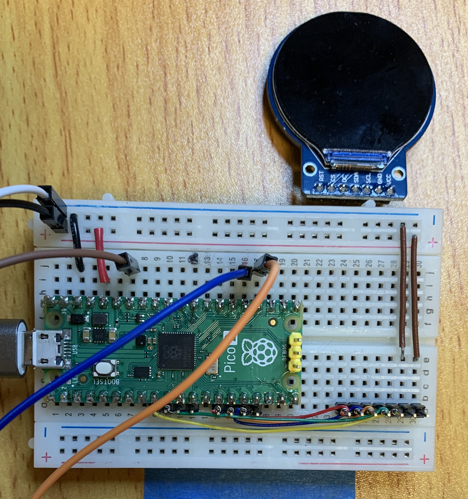

# Pico-GFX - Integrated Pico2 Development for Micropython + LVGL with EEZ Studio


## Overview
This project will show how to integrate EEZ-Studio (a host-side graphic development tool) 
for creating GUIs targeting LVGL+Micropython embedded platform, such a the Pico2.  
 
As an example application, as "digital pocket watch", modeled after a real, railroad-grade pocket watch is provided.  
A rotory-encoder is use to emulate the crown winder.
  

 


## Hardware Assumptions 
* Raspberry Pie RP2350 (Pico2)
*  Round TFT Display 240x240  LCD Display SPI DC3.3V
*  KY-040 Rotory-encoder with push-button switch
*  wiring and connectors

## Software Assumptions
* Developing on Ubuntu V26.04 (V24.04 may be ok, but untested)
* EEZ-Studio installed: example ~/bin/eez-studio/squashfs-root
* mpremote installed
  
## Basic Pico-GFX Install
```
cd ~/micropython_projects
git clone https://github.com/foldedtoad/pico-gfx.git
cd pico-gfx

cd ~/micropython_projects/pico-gfx/firmware/lvgl_micropython
git submodule update --init lib/micropython     # moves MicroPython to 8dc05cd
cd ~/micropython_projects/pico-gfx

tools/build_fw.sh
tools/deploy.py
```

## How to use the crown to set the time

| Action             | Result                                                        |
| ------------------ | ------------------------------------------------------------- | 
| Click              | Enter set mode (minutes). The seconds hand parks at 0.        |
| Turn	              |  ±1 minute per click; fast spins jump 5 or 15 minutes.        |
| Double-click	      | Switch to hours. The seconds hand moves to 30, pointing down. |
| Turn (hour mode)   | ±1 hour per click; the minutes stay as they are.              |
| Double-click again	| Back to minutes, with the seconds hand at 0.                  |
| Single click	      | Save the time; the watch restarts from :00.                   |
| Hold about 1 s     | Cancel and keep the old time.                                 |

