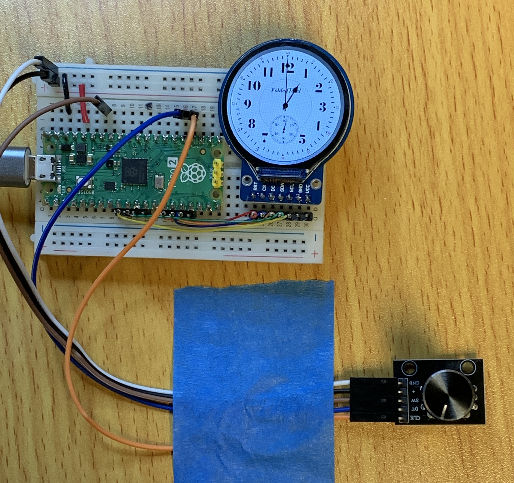

# Pico-GFX - Integrated Pico2 Development for Micropython + LVGL with EEZ Studio


## Overview
Assumptions 
* Developing on Ubuntu V26.04 (V24.04 may be ok, but untested)
* EEZ-Studio installed: example ~/bin/eez-studio/squashfs-root
* Raspberry Pie RP2350 (Pico2)
*  Round TFT Display 240x240  LCD Display SPI DC3.3V
*  KY-040 Rotory-encoder with push-button switch

## Installing Pico-GFX
```
cd ~/micropython_projects
git clone https://github.com/foldedtoad/pico-gfx.git
cd pico-gfx

cd ~/micropython_projects/pico-gfx/firmware/lvgl_micropython
git submodule update --init lib/micropython     # moves MicroPython to 8dc05cd
cd ~/micropython_projects/pico-gfx

tools/build_fw.sh
tools/deploy.py
```


